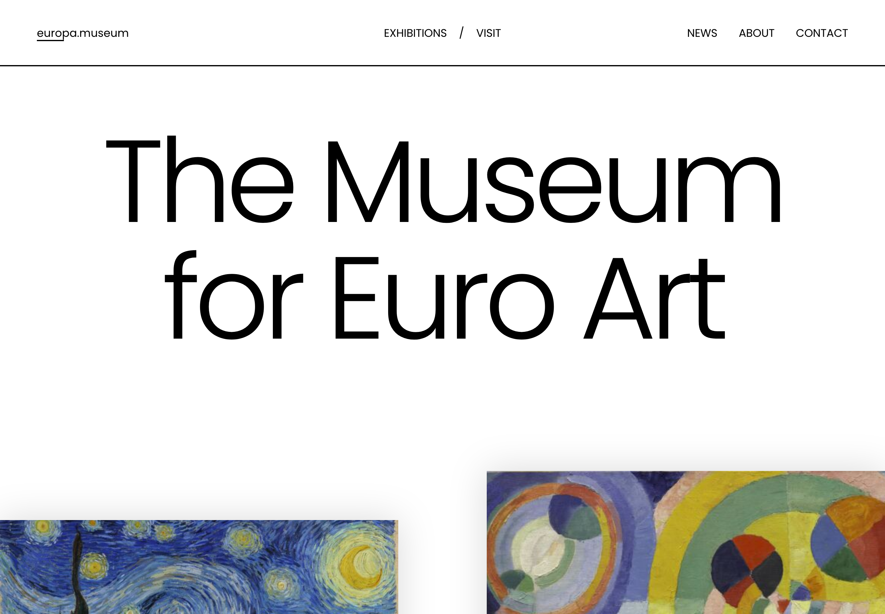

<h1 align="center">Europa Museum — Craft CMS Demo</h1>



## Overview

_Europa_ is a fictitious art museum website build with [Craft CMS](https://craftcms.com). This repository houses the source code for our demo, which you can try for yourself by visiting [craftcms.com/demo](https://craftcms.com/demo?kind=europa).

We’ve also included instructions below for setting up the demo in a local development environment with [DDEV](https://ddev.com/).

_Europa_ shows off many of Craft’s [core features](https://craftcms.com/features) and includes some [popular plugins](https://plugins.craftcms.com/) to spark your curiosity.

### Development Technologies

- [Craft CMS 5.x](https://craftcms.com/docs/5.x/)
- PHP 8.5
- PostgreSQL 17
- Native [Twig](https://craftcms.com/docs/5.x/development/twig.html) templates
- Built on the [Yii 2 framework](https://www.yiiframework.com/)

Read more about Craft’s [technical requirements](https://craftcms.com/docs/5.x/requirements.html) in the official documentation.

### Front End Dependencies

_Europa_’s front-end was built with modern Javascript and CSS tools. Craft itself has no rules about how you structure your front-end code—so we’ve taken the opportunity to share a handful of techniques that couple Twig templates with front-end interactivity.

- [Laravel Mix](https://github.com/JeffreyWay/laravel-mix#readme) to manage compilation of [Sass](https://sass-lang.com/) and JavaScript
- [GSAP](https://greensock.com/gsap)
- [Lazysizes](https://github.com/aFarkas/lazysizes#readme)

## Local Development

This repository is ready to use with [DDEV](#ddev).

> [!TIP]
> If you’re using a different local environment, refer to Craft’s [requirements](https://craftcms.com/docs/5.x/requirements.html) and our [installation instructions](https://craftcms.com/docs/5.x/install.html).

### DDEV

[DDEV](https://ddev.com/) is our recommended local development environment, for Craft developers at any level of experience. Our [quick-start guide](https://craftcms.com/docs/5.x/install.html) covers this process in detail—but we’ve done the config for you, so all that’s required is…

```bash
git clone https://github.com/craftcms/europa-museum.git
cd europa-museum
ddev start
ddev composer install
ddev craft db/restore seed.sql --interactive=0
ddev craft setup/security-key
```

Create a user for yourself with the CLI:

```bash
ddev craft users/create --admin
# ...
ddev launch admin
```

### Front End

Run `npm install` with Node.js 14.15.0 or later.

> [!TIP]
> DDEV users can run npm commands within the application container, via `ddev npm ...`!

These development scripts are available in `package.json`:

- `npm run watch` to watch and automatically recompile assets for local development
- `npm run sync` to watch files and reload with BrowserSync for local development
- `npm run dev` to compile assets for local development
- `npm run prod` to compile optimized assets for production

If you use a different site URL, update `DEFAULT_SITE_URL` in `.env` or the production build process will fail:

```
DEFAULT_SITE_URL=https://europa.ddev.site
```

## Contributing

Thank you for considering contributing to this demo! It is generated by [Maestro](https://github.com/craftcms/maestro), which builds all of Craft's starter kits, so changes made directly in this repository are overwritten. Please make all contributions through Maestro.

## License

The source code of this project is licensed under the [BSD Zero Clause License](LICENSE.MD) unless stated otherwise.

The imagery used by this project is the property of each respective license holder. You are not free to use it for your own projects.
