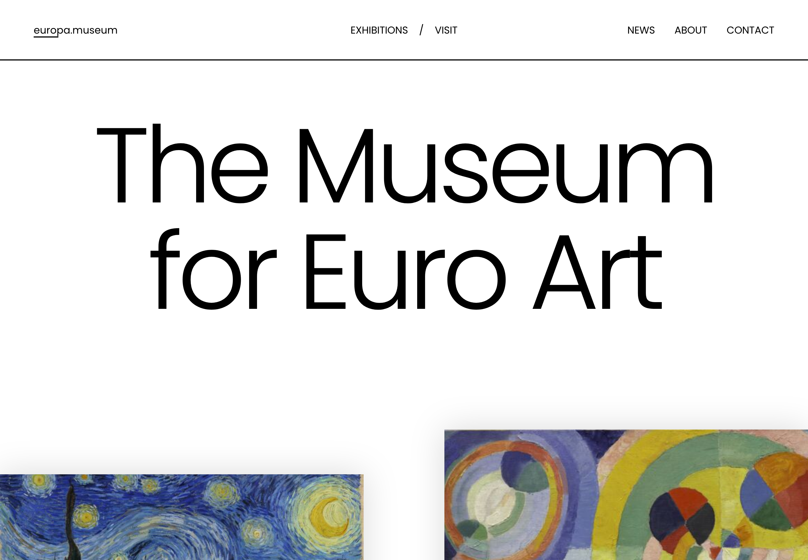

<h1 align="center">Europa Museum — Craft CMS Demo</h1>



## Overview

_Europa_ is a fictitious art museum website build with [Craft CMS](https://craftcms.com). This repository houses the source code for our demo, which you can try for yourself by visiting [craftcms.com/demo](https://craftcms.com/demo?kind=europa).

We’ve also included instructions below for setting up the demo in a local development environment with [DDEV](https://ddev.com/).

_Europa_ shows off many of Craft’s [core features](https://craftcms.com/features). This version runs on Craft 6, which is still in alpha, and uses no third-party plugins. Its rich text is edited with [CKEditor](https://github.com/craftcms/ckeditor), installed from its Craft 6 development branch until it has a release.

### Development Technologies

- [Craft CMS 6.x](https://github.com/craftcms/cms/tree/6.x) (alpha)
- PHP 8.5
- PostgreSQL 17
- Native [Twig](https://craftcms.com/docs/5.x/development/twig.html) templates
- Built on [Laravel](https://laravel.com/)

### Front End Dependencies

_Europa_’s front-end was built with modern Javascript and CSS tools. Craft itself has no rules about how you structure your front-end code—so we’ve taken the opportunity to share a handful of techniques that couple Twig templates with front-end interactivity.

- [Vite](https://vite.dev/), through Laravel’s Vite plugin, to compile [Sass](https://sass-lang.com/) and JavaScript
- [GSAP](https://greensock.com/gsap)
- [Lazysizes](https://github.com/aFarkas/lazysizes#readme)

## Local Development

This repository is ready to use with [DDEV](https://ddev.com/).

```bash
git clone --branch 6.x https://github.com/craftcms/europa-museum.git
cd europa-museum
ddev start
ddev composer install
ddev php artisan key:generate
ddev php artisan craft:db:restore seed.sql --no-interaction
ddev php artisan craft:up
```

Create a user for yourself with the CLI:

```bash
ddev php artisan craft:users:create --admin
# ...
ddev launch admin
```

### Front End

Built assets are committed in `public/build`, so the site works without Node.js. To change the styles or scripts in `src/`, run these in the application container with `ddev npm ...`, or locally:

- `npm install` to install the dependencies
- `npm run dev` to start Vite’s dev server, which reloads the page as you edit
- `npm run build` to compile optimized assets into `public/build`

### Content

The demo’s content and content model live in `seed.sql`. After changing either on a database restored from it, run `php artisan demos:dump` to write them back. `php artisan demos:seed` gives the news articles recent post dates.

## Contributing

Thank you for considering contributing to this demo! It is generated by [Maestro](https://github.com/craftcms/maestro), which builds all of Craft's starter kits, so changes made directly in this repository are overwritten. Please make all contributions through Maestro.

## License

The source code of this project is licensed under the [BSD Zero Clause License](LICENSE.MD) unless stated otherwise.

The imagery used by this project is the property of each respective license holder. You are not free to use it for your own projects.
